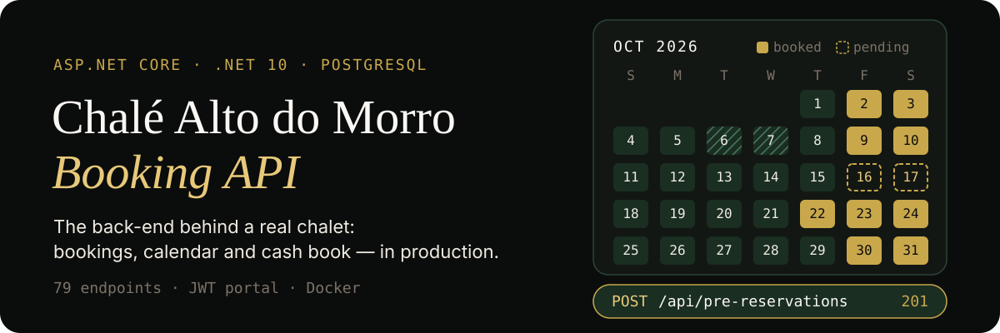
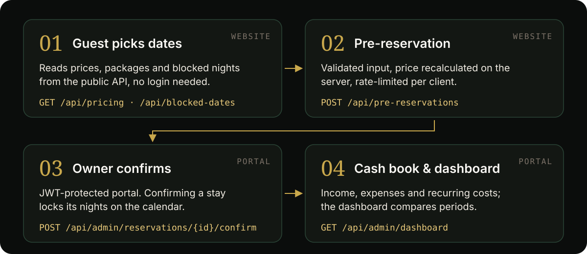

<p align="center">
  
</p>

The REST API behind [Chalé Alto do Morro](https://chalealtodomorro.com.br), a romantic chalet for two in Santo Antônio da Patrulha, Brazil. It serves two clients: the **public website**, where guests check prices and send pre-reservations, and a **private portal**, where the owners confirm stays and run the business. It is in daily use.

## How a booking flows

<p align="center">
  
</p>

1. **Guest picks dates.** The website reads prices, packages, add-on kits, gallery and blocked nights from public, unauthenticated routes.
2. **Pre-reservation.** `POST /api/pre-reservations` validates the guest's data (including CPF), checks availability and recalculates the price on the server, so the client never decides what a stay costs. The route is rate-limited.
3. **Owner confirms.** In the portal, `POST /api/admin/reservations/{id}/confirm` turns a pre-reservation into a booking and locks its nights, so two guests can't confirm the same date.
4. **Cash book and dashboard.** Owners record income, expenses and recurring costs; the dashboard compares revenue, occupancy and cash flow against the previous period.

## What's inside

| Area | Routes |
| --- | --- |
| Public (website) | `pricing` · `blocked-dates` · `packages` · `extras` · `gallery` · `videos` · `schedule` · `pre-reservations` |
| Admin (portal, JWT) | `reservations` · `calendar` · `guests` · `pricing` · `packages` · `kits` · `blocked-dates` · `gallery` · `videos` · `cashbooks` · `cash-categories` · `recurring-expenses` · `dashboard` · `settings` |
| Auth | `POST /api/auth/login` · `GET /api/admin/me` · password change |

79 endpoints in total, documented with OpenAPI and browsable in [Scalar](https://scalar.com) at `/scalar` in development.

**Engineering choices**

- **ASP.NET Core Identity + JWT Bearer** for the portal; public routes stay anonymous.
- **Business rules live in the domain** (`BookingRules`, `OccupancyRules`, `CashBookRules`, `DashboardRules`) and are covered by unit tests.
- **Rate limiting** per client: a global limit plus tighter ones for login, password change and pre-reservations.
- **Errors as `ProblemDetails`** through a global exception handler, with Identity messages in Portuguese.
- **Uploads checked by file signature**, not by extension, behind an `IFileStorage` interface (local disk or S3, chosen by configuration).
- **EF Core + PostgreSQL** with snake_case naming, and a `/health` check that also tests the database connection.
- **Docker** for local Postgres and for production behind Caddy.

## Run it locally

You need the [.NET 10 SDK](https://dotnet.microsoft.com/download) and Docker.

```bash
# 1. Start PostgreSQL (port 5433) and Adminer (port 8080)
docker compose up -d

# 2. Configure secrets (never committed)
cd ChaleAltoDoMorroAPI
dotnet user-secrets set "ConnectionStrings:Default" "Host=localhost;Port=5433;Database=chale_alto_do_morro;Username=chale_admin;Password=chale_dev"
dotnet user-secrets set "Jwt:Key" "<at least 32 random characters>"
dotnet user-secrets set "AdminSeed:Email" "you@example.com"
dotnet user-secrets set "AdminSeed:Password" "<a strong password>"

# 3. Create the schema and run (first time: dotnet tool install -g dotnet-ef)
dotnet ef database update
dotnet run
```

Open <http://localhost:5084/scalar> to explore the API. In development, the app seeds sample prices, kits and blocked dates, and creates the admin user from `AdminSeed`.

Run the tests from the repository root:

```bash
dotnet test
```

## Project layout

```text
ChaleAltoDoMorroAPI/
├── Controllers/   Public/ (website) and Admin/ (portal)
├── Domain/        entities and business rules
├── Services/      application services used by the controllers
├── Data/          DbContext, configurations, migrations, seeders
├── Storage/       IFileStorage: local disk and S3
└── Program.cs     auth, CORS, rate limiting, OpenAPI, health check
ChaleAltoDoMorroAPI.Tests/   unit tests for rules and validation
docs/                        task plan, API contracts, business rules, deploy guides
```

## How this was built

I'm a C# developer, and I built this API to learn ASP.NET Core on a real project for my family's business, using AI deliberately at two stages:

- **AI as a mentor.** For the foundation (tasks 0 to 8: data model, public routes, booking rules, pre-reservations, Identity + JWT), I wrote the code myself while Claude explained, reviewed and gave hints. Those rules are in [`CLAUDE.md`](CLAUDE.md). For later tasks the mentoring got more hands-on: Claude pointed out the approach and the code, and I implemented it step by step, learning as I went.
- **AI as a pair programmer.** For some features I worked with Claude Code as a pair programmer, reviewing what went in. Those commits carry a `Co-Authored-By: Claude` trailer.

The plan and the decisions are in [`docs/TASKS.md`](docs/TASKS.md); the contracts with the website and the portal are in [`docs/CONTRATO_SITE.md`](docs/CONTRATO_SITE.md) and [`docs/CONTRATO_PORTAL.md`](docs/CONTRATO_PORTAL.md).

---

<details>
<summary><b>🇧🇷 Resumo em português</b></summary>

API REST em ASP.NET Core (.NET 10) do Chalé Alto do Morro, em Santo Antônio da Patrulha/RS. Atende o site público (preços, datas bloqueadas e pré-reservas) e o portal de gestão dos donos (confirmação de reservas, calendário, hóspedes, Livro Caixa e dashboard). Usa PostgreSQL com EF Core, Identity + JWT, rate limiting e Docker, e está em uso diário. A construção foi um projeto de estudo com IA: na base, eu escrevi o código com o Claude como mentor; nas tasks seguintes, ele indicava o caminho e o código e eu implementava aprendendo; e algumas funcionalidades foram feitas com o Claude Code como par de programação.

</details>
